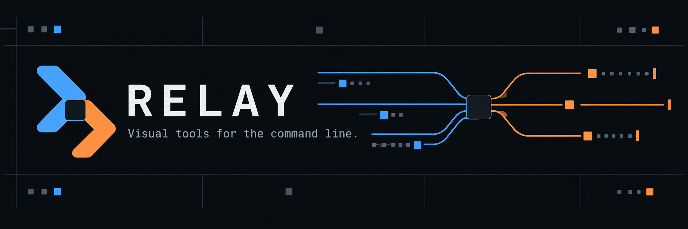
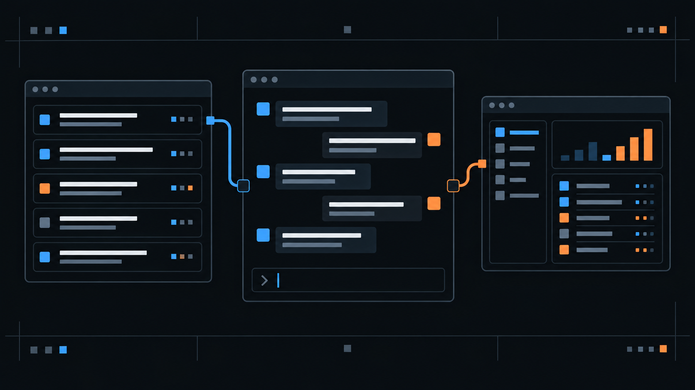

  

Relay is a small collection of reusable command-line interfaces. We make server output easier to read, conversations easier to follow, and terminal applications easier to assemble.

  

## What we are building

| Server activity | Conversations | Application shells |
| --- | --- | --- |
| Structured cards for requests, JSON, errors, and process events. | A reusable chat interface with streaming messages and multiline input. | Navigation and page layouts for terminal dashboards and small tools. |

Each project includes a working demonstration. You can see the interface before connecting it to your own application, then use the pieces you need.

The first repository will be published after its demo, tests, documentation, and release package are ready.
